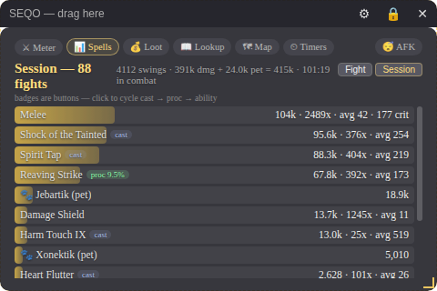
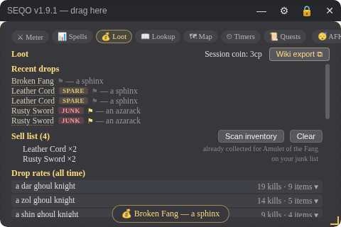
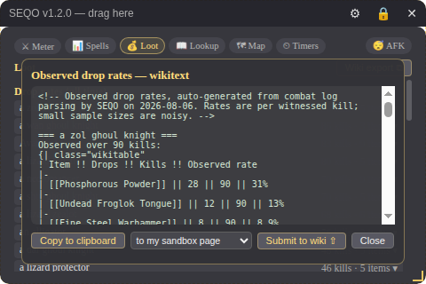
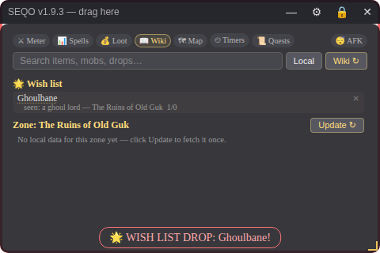
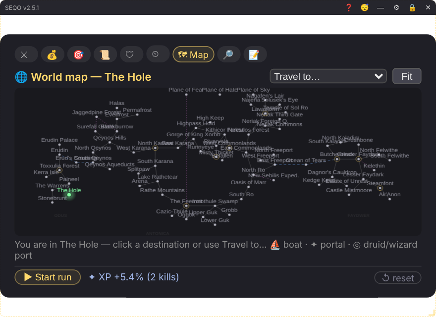
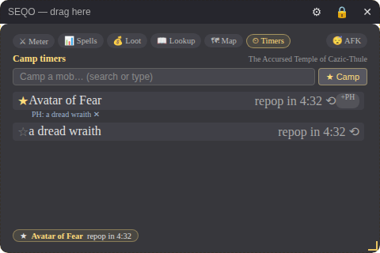
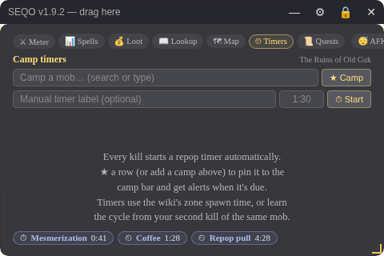
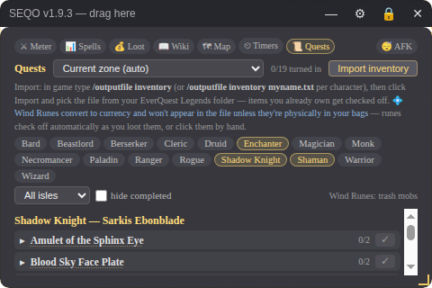

# SEQO — Simple EQ Overlay

**A log-powered companion overlay for EverQuest Legends on Windows 11.**
Live DPS meter · group & session breakdowns · loot tracking with real drop rates · a zone-needs tab AND pop-out that watch for what you're hunting · race/class/deity unlock tracking · 💀 Slayer achievement tracker with hunting routes and faction warnings · optional class spell quest checklists · epic checklists that understand turn-ins · an experimental ⚔ Class tab: trio gear advisor + a buff lab running on the game's own spell data · item/zone/quest lookup with in-app guide pages · world travel routing · learned camp timers with spawn windows · rare-spawn, charm-break, exact buff-fade & AFK alerts · cross-computer sync with honest status · built-in help on every feature.

> ### New in v2.5 — [release notes](https://github.com/RealMaeel/seqo/releases/latest)
> **💀 Slayer achievements**: all four groups from your achievements export with live progress bars, closest-to-done first, meta-chains you can click through — and a 🧭 route read-out per target that tells you where that family hunts and what the kills COST you in faction, checked against your own standings and the unlocks you're grinding.
> **⚔ Class tab** *(experimental — see below)*: your trio auto-detected from /who, a per-slot **gear advisor** scored for YOUR three classes with editable stat weights and an upgrade-tier compare, and a **buff lab** running on the game's own spell files — live buffs with countdowns, exact fade identification, "didn't take hold" explained by name, and a loadout builder that fits your focus stats into your spell gems.
> **🧙 Spell quests**: Tashania, Ice Comet, Divine Might, Life Leech and Call of Flame as tracked checklists — ⭐ one and its hunted pieces join the zone-needs list.
> **🎯 Needs is a tab now** too — same list as the pop-out, pick your flavor. Spell-quest pieces included.
> **📂 Login popup**: a fresh login (or starting SEQO mid-session) brings up the /outputfile commands as copy buttons that tick themselves off as the files land.
> **Nine tabs, reordered** — inactive tabs shrink to icons so everything fits. Scrolling no longer snaps to the top when live data updates. Wiki lookups batch 50 pages per request and catalog updates only re-read what changed.

SEQO never touches the game. It reads the log file EverQuest Legends already writes to disk — the same technique GamParse and nParse used safely for two decades of classic EQ. **No injection, no memory reading, no automation. Nothing for anti-cheat to object to.**



---

## Installation

### For players (recommended)

Grab **`SEQO-Setup-x.y.z.exe`** from the [Releases](../../releases) page and run it — installs per-user (no admin), adds a Start Menu entry, includes an uninstaller. A **portable** exe is also published for the no-install crowd (note: portable unpacks itself each launch, so it starts slower).

> **Windows SmartScreen** will say "Windows protected your PC" the first time, because SEQO isn't code-signed (certificates cost hundreds a year; this is a free fan tool). Click **More info → Run anyway**. The source is right here in this repo if you'd rather audit or build it yourself.

Your data (databases, settings) lives in `%APPDATA%\SEQO` and survives updates and uninstalls.

### From source (tinkerers)

1. Install [Node.js LTS](https://nodejs.org).
2. Download this repository (green **Code** button → Download ZIP) and unzip anywhere, e.g. `C:\SEQO`.
3. In that folder, open a terminal (click the address bar, type `cmd`, Enter) and run:
   ```
   npm install
   npm start
   ```

### Building releases (maintainers)

On Windows, `npm run dist` produces both `SEQO-Setup-x.y.z.exe` (installer) and `SEQO-Portable-x.y.z.exe` in `dist\`. Attach both to a GitHub Release. (Building Windows binaries from Linux requires wine.)

### First-time setup (two minutes)

1. In game, make sure logging is on (`/log`). Your log lives in the game's `Logs` folder as `eqlog_<Name>_<server>.txt`.
2. In SEQO: ⚙ **Settings → Character & Log → Choose…** and pick that file.
3. In game, type `/outputfile inventory`, `/outputfile achievements` and `/outputfile faction` once — SEQO finds the files next to your log and keeps everything synced from then on.
4. Position the overlay, then press **Ctrl+Alt+O** to lock it and play.

> **Fullscreen note:** overlays can't draw over true exclusive fullscreen. Windows 11's default "fullscreen optimizations" usually makes it work anyway — if SEQO doesn't appear over the game, switch EQ Legends to **borderless/windowed fullscreen** (looks identical).

---

## The overlay itself

| Action | How |
|---|---|
| Move | drag the title bar (edit mode) |
| Resize | drag the gold corner grip — everything inside scales, keeping its ratio |
| Lock (click-through) | **Ctrl+Alt+O**, or the 🔒 button. While locked, clicks pass through to the game — but every button and control still works when your mouse is over it (start a run, expand a bar, change tabs) |
| Unlock | **Ctrl+Alt+O**, the floating **🔓** at the top-right while locked, or the tray menu |
| Show / hide | **Ctrl+Alt+H**, or single-click the tray icon |
| 📝 Notes | a plain text scratchpad in the tab bar — saves as you type, syncs between your computers. For the stuff you always forget, like `/tasko` |
| Minimize | the **—** button; SEQO appears in the taskbar while minimized, and leaves it again on restore |
| ❓ Help | the title-bar **❓** opens built-in help: one short page per feature plus an FAQ, readable offline |
| 😴 AFK watch | also in the title bar now (floats top-right with 🔓 while locked) |
| Style | opacity, font, size, accent color — ⚙ Settings → Appearance |

**Clicking while locked:** the tab strip and interactive lists stay usable even in click-through mode — controls become clickable the moment your mouse is over them, and everywhere else clicks reach the game. The strip dims while locked so it stays out of your way.

If a hotkey is stolen by another app (Discord and GeForce overlays are the usual suspects), SEQO warns you at launch and the on-screen controls cover everything.

---

## ⚔ Meter

Live per-fight combat stats: your DPS, total damage, max hit, crits, damage taken, and self-healing, plus a damage bar for every combatant — you, your pets, groupmates. Fights are detected automatically; eight quiet seconds ends one, and the meter shows your last fight while idle.

- **Bottom bar** (new in 2.4): a slim bar along the overlay's bottom edge, **on every tab**. It holds the labeled **▶ Start run / ⏹ End run** button (with a live clock while a run is going) and the session **XP/AA readout**, fed by the game's own per-kill experience percentages — "✦ XP +19.1% (8 kills) · 19.1%/hr · 11.5% into L47 · ~4.6h to 48 · AA +2 · 145 total". Position and time-to-level appear once a level-up has been seen; at the level cap only the AA line shows. The **↺ reset** chip restarts the pace counters (kills, %, per-hour) while keeping your level position and AA total — handy after a loadout swap. Level-ups get a 🎉 DING alert.
- **Copy your parse** (new in 2.3): 📋 chat copies a one-line summary that fits in-game chat (`Drelzna (0:45) — Maeel 12.4k @276 | …`), 📋 full copies a multi-line breakdown for Discord. The top-N chooser (1–10) sets how many names go in.
- **Click any bar for damage by spell** (new in 2.2) — yours or anyone else's: melee, each spell, each proc, with totals, share and hit counts. Click again to collapse. Your own expanded row includes your pets' sources when they're folded in.
- **Pets count.** Summoned pets are detected from their speech; charmed mobs are recognized instantly from the "has been charmed" landing line (and when they address you as Master). **Pet damage folds into your row** ("Maeel +🐾") and into your stat tiles — that's your real output. Toggle in Settings → Appearance.
- **Silent pet?** Some pets never speak. Every other player's bar has a **🐾 button on its right edge** — click it to mark that combatant as your pet (click again to unmark). Named pets are remembered forever; article-named mobs are treated as your active charm.
- **Damage shields count** ("burned by YOUR flames") and attribute correctly to you, groupmates, or enemies.

## 📊 Σ Session (was the Spells tab)

Lives under the Meter tab now: the **⚔ Fight / Σ Session** buttons switch between the live meter and your whole-session damage by source — melee, each spell, each proc, damage shield — with totals, counts, averages, and crits. (Per-fight sources are on the meter itself: click any bar.)

- **Session** aggregates every fight since launch — thousands of swings, which is what makes proc rates statistically real.
- **Proc detection.** Damage from a spell you never cast is flagged as a proc with its rate per melee swing. The log can't distinguish procs from activated abilities, so **every badge is a button**: click to cycle **cast → proc → ability**. Corrections persist forever.
- Pets appear as 🐾 rows in both views; session header shows you + pets = combined.

## 💰 Loot

**▶ Run tracker**: click **Start run** — on this tab or on the bottom bar from anywhere — before a personal instance (or any farming session) and SEQO counts every item and every coin split from that moment. If you zone into an instanced copy of a zone without a run going, a toast reminds you to start one — a live strip shows duration, coin, **motes with a per-hour rate** (✨ 14 motes (9.2/hr), also in both copy formats), item count and coin/hour, updating each second. **full list ▾** expands every drop of the run (motes highlighted ✨); **End run** freezes the summary and keeps your recent runs listed for comparing clears.

**🧹 Cleanup** (new in 2.3): a panel in the **dock** — an always-on-top strip that snaps to the overlay's bottom edge and follows it around, so the list stays visible over the game while you sort bags (📌 detaches it, ✕ closes it, drag its bottom edge for height). Open it with the button on this tab. It lists every stored item in strict **location sections — 🎒 Bags, 📦 Character storage, 🏦 Bank** (shared bank folded in, tagged) — name-sorted, with chips to filter by verdict (All · Needed · Gear · Unknown · Job done) and per-location counts when a stack is split ("×5 · +16 elsewhere", hover for the exact split). Every item carries an honest verdict — **still needed** (some class's PoS quest, epic, BiS list, grind or your own flags want it, reason shown), **job done** (safe to vendor/destroy), or **unknown**. Unknowns **look themselves up automatically** the moment the window opens or new ones appear (the 🔎 button remains as a manual re-run; a network failure pauses the scan without mis-caching anything). Each answer is remembered forever in a knowledge base that syncs between your computers — the lookup your main did serves your mule. Rows show **every quest** that uses the item, and the quest chain prints right on the row — "↳ Vampire Teeth → Electrum-Bladed Wakizashi → needed for: Call of Flame Quest" — resolved once during the scan and remembered. Clicking a quest shows its full rewards, and a ← in the dock's title bar walks back through whatever you opened. A sort control orders each pile by name, category, count or location; tradeskill mats get labeled with their craft ("tradeskill – brewing"); wearable items with no quest use land in their own **🛡 Gear** pile; exaltation items are recognized by name and kept. A copyable `/outputfile inventory` reminder sits at the top so the scan always runs against your real bags. Rows leave the list live as you destroy or vendor items (vendor sales are read from the log too), and 🗑 flags an item junk forever — it drops into Job done. The old Loot-tab sell list is retired; this pile is its replacement. Ground truth is always your inventory file: one `/outputfile inventory` re-syncs exactly. Two safety nets protect it: the game writes the export file over a second or two with the **Personal-Depot** section near the end, so SEQO waits until the file stops growing before reading it (no more half-written exports with missing storage) — and if an export ever does lack the depot section, the last good depot is carried forward (noted on the status line) until a complete one replaces it.

**⭐ Rare checklist** (new in 2.2): during a run, the strip also tracks the zone's **named mobs** — every rare you kill gets a green ✓ (with a toast), and the ones still up stay listed with ○ so you know what's left in the crawl. The known-rares list is built from [EQLForge](https://eqlforge.com/)'s per-zone Notable NPCs (the community's dungeon-crawl rare lists — support them) plus the wiki zone page's Boss/Named entries and drop tables, and it refreshes automatically the first time you start a run in a zone with old or missing data. Generic mobs and loot objects (a haunted chest, an ashenbone drake) are filtered out — only proper names count, unless a source explicitly calls the mob a boss — and if something slips through, click it in the list to remove it from that zone's rares for good ("restore" on the Rares line brings them back). The same filter applies to the ⭐ RARE UP alerts. This pairs with the game's own [Dungeon Crawl](https://eqlwiki.com/Dungeon_Crawl) instances, where clearing every rare is the objective.

**🎯 Zone needs** (2.4, a full tab since 2.5): the same list lives in two places — the **🎯 Needs tab** in the overlay, and the **Needs** button's slim pop-out strip under the overlay listing everything you still need **from the zone you're standing in** — ⭐ starred gear, ⚔ epic pieces (true remaining counts), 🔓 unlock turn-ins with live counters that tick the moment the loot line hits your log — each row naming the mobs that drop it, click-through to full item details — and since 2.5, 🧙 pieces of any spell quest you're tracking. It's persistent (follows you between zones, reopens after a restart), **minimizable to a one-line "🎯 4 needed here" bar**, scrollable, and height-draggable. Rows flash when their item just dropped, so a glance tells you what mattered.

Every kill and every looted item is recorded automatically to a permanent database.

- **Recent drops** as they happen (with an on-screen toast), session coin earned.
- **Drop rates (all time):** click a mob to expand its items — `Fine Steel Rapier: 12/21 (57%)`. Rates are per witnessed kill, recorded **per zone** (the same mob name can drop differently in different zones), and sharpen forever as you play.
- **Difficulty tiers handled correctly:** EQ Legends' D0–D4 tiers (Awakened/Adaptive/Fused/Refined) drop the same items at +N levels, so drop rates **pool across tiers** for maximum sample size — while **mob strength records per tier**, since that's what scales.
- **Items are links** — click any item and its full detail card opens in the dock: stats with the upgrade slider, every effect with its wiki description spelled out ("Mana Preservation II — reduces mana cost up to 10%", clickable through to every item carrying it), your own drop data, the wiki text and eqlegendstools matches in readable full-width rows, and deep links to the community databases.
- **Keep-or-sell verdicts:** the game marks half its drops "quest item," but the ones that matter get a badge on the recent-drops list the moment you loot them — **KEEP** (a Plane of Sky quest of *your* classes needs it, with quest name and progress), **SPARE** (you've already collected one), **SELLABLE** (that quest is turned in), **OTHER CLASS** (only classes you don't play use it). Verdicts come straight from your live quest progress on the Quests tab.
- **⚑ Flag anything yourself:** click the flag next to a drop to cycle *always keep → junk → clear*. Your list is remembered forever, synced between computers, and flagged items announce themselves with a louder toast (⭐ keep / 🗑 junk) whenever they drop — tradeskill mats, epic pieces, known vendor trash. Unknown items stay quiet; click one to search the wiki for quests that mention it.
- **Wiki export** (the button appears once a wiki account is configured in ⚙ Advanced) generates a full, ready-to-paste contribution document, organized by zone. Each mob's entry includes: the pooled drop table with rates and sample size, a **strength-by-difficulty table** (level from your /con, max hit, average hit, sample, and casts seen per tier — higher tiers add classes to mobs, and your data shows it), and **measured respawn times** from your camp cycles. Everything is phrased in the wiki's own terminology (`[[Difficulty Level]]`, D-labels) so editors can use it verbatim.
- With an eqlwiki account configured you can **submit directly**: to your personal sandbox page (default, zero risk) or to each mob's talk page. What you see in the export window is exactly what gets posted.





## 🔎 Lookup (was Data)

A **local-first** game database pulling from **multiple community sources**: everything is served from a cache on your disk; the network is touched only when you click an update button.

- **Update from sources** on any item fetches its eqlwiki page AND searches eqlegendstools.com's databases (weapon procs, BiS gear, clickies, focus/worn effects) in one click — each source shown in its own credited section, all cached for offline use. The eqlegendstools page cache refreshes at most weekly.
- **Sources ⟳ search** queries every online source at once; results are labeled by where they came from (🌐 eqlwiki / 🧰 eqlegendstools) and open in the overlay.

Every item detail also has a **"Look up on"** row — one credited button per community database (eqlwiki, EQLBase, EQ Legends Tools, Loadout Legends, Gnoll Guard) that opens that site's search for the item in your browser, for when the local cache and the wiki come up short.

- **Current zone:** entering a zone is detected from the log. Click **Update ⟳** once per zone to pull its named mobs, their drops (with rarities), the zone spawn timer, and its quest list from [eqlwiki.com](https://eqlwiki.com) — offline forever after. Your own kill counts and observed drop rates display beside the wiki's data.
- **Search** covers everything cached plus your loot history; **Wiki ⟳** searches online and caches what you open.
- **Item pages** include an **upgrade slider (+0…+10)** that recomputes stats using the game's documented tier rules — +10% per tier (+5% weapon damage), minimum +1, delay unchanged.
- **Check for updates** (Settings → Wiki & Data) compares cached page revisions against the wiki and re-downloads only what changed.

- **🌟 Wish list:** open any item or spell and click **☆ Wish**. The Data tab keeps your wish list pinned up top, each entry showing how to get it: mobs you've personally seen drop it (with your measured rates), its PoS quest recipe if it's a quest reward, and the wiki's "drops from" data. Zone into somewhere a wished item drops and SEQO toasts you; when it actually drops, you get a loud **WISH** alert and badge. Synced across computers.



## 🗺 Map

A world travel map of all of Norrath — every zone, every connection (⛵ boats, ✦ portals), with **the zone you're standing in glowing green** (zone detection is automatic from the log). **Click any destination** and SEQO highlights the shortest route and spells it out — crossings counted, boats and portals marked.

The map matches EQ Legends' actual world: **New Sebilis Expedition** (door in NW North Ro), **Jaggedpine Forest** (teleporters in Surefall Glade and at the bottom of Blackburrow), **Kelethin** as its own zone, and **Gorge of King Xorbb** under its Legends name.

*(The old per-zone /loc dot map is gone as of v2.1.0 — it needed constant /loc pressing to be useful. The world map does the job it was actually used for: "how do I get there?")*



## ⏱ Timers

**Camp timers:** every kill starts a repop countdown automatically. Timers are **learned from your own kill-to-kill gaps** — several cycles vote, missed-cycle outliers are dropped, and mobs with genuinely varying spawns get a **spawn window** ("15–30m"): an alert when the window opens and another when it's past. Nothing is learned inside **instanced copies** or across a **zone transition**, so timers stay honest. Every countdown carries a trust mark: **⟲** learned from 3+ cycles · **~** tentative (1–2 cycles) · **~wiki** zone-wide default · **✎** set by you. The **✎** on any row lets you set a timer yourself — `6:40`, `25m`, or `15-30` for a window in minutes — and one empty "set" puts it back on automatic. Manual timers beat every other source, which is also the answer for raid-instance bosses on daily/weekly reset clocks where no measured cycle applies.

- **Camp a mob:** type its name in the "Camp a mob…" box (suggestions from the zone's named list and your history) or ★ any timer row. Camped mobs pin to the **camp bar at the bottom of the overlay — visible on every tab** — and alert when the repop is due.
- Measured respawn cycles also flow into the **wiki export**, per zone and difficulty tier — camp data most wikis have never had.
- **Placeholders:** click **+PH** on a camp, then click the placeholder's row. Any linked PH death resets and teaches the shared spawn cycle — proper classic camp mechanics. Links persist per zone.
- **UP NOW:** if a tracked mob shows any combat activity, its timer flips to ⚔ UP NOW instead of a stale countdown, and resets when it dies.



**Manual timers:** on the Timers tab, type an optional label and a time — `90`, `1:30`, `5m`, or `2h` — and hit ⏱ **Start**. The countdown chip shows at the bottom of the overlay **on every tab**, goes red at 6 seconds, and pings at zero. Click a manual chip to cancel it. Start as many as you like.

**Spell timers:** Settings → Alerts → *Spell timers*, one per line: `Mesmerization = 42` (or `m:ss`). For spells with landing lines (mez: "X has been mesmerized."), chips are **per mob, by name** — "Mesmerization · spiroc revolter 0:39". AE mez landing on three mobs makes three named chips; re-mezzing one refreshes its chip; a mob breaking mez (worn off, or "awakened by") retires **only that mob's chip**; the expiry ping tells you *which* mob is waking. Spells without landing lines get a generic per-cast chip; interrupts and resists cancel only the just-cast chip. Ranks match automatically — "Mesmerization" covers Mesmerization VII. Red at 6 seconds, sorted soonest-first: the leftmost chip is your next re-mez.



## 📜 Quests

A quest tracker for **any zone**, with a deep hand-built database for Plane of Sky. The tab's sub-views sit in a **chip row** — 📜 Quests · 🔓 Unlocks · 💀 Slayer · 🧙 Spells · ⚔ Epics · ✨ Exalts — one click each, no more hunting in a dropdown.

The zone selector defaults to wherever you are (it follows you as you zone) and can be pointed anywhere manually. For most zones you get the wiki's quest list from your local cache — an Update button fetches the zone page's Quests section once, each quest is a click away from its wiki page, and ✓ done-states persist and sync. The wiki files quests **by class**, though, so most zone pages list few or none — that's what **📇 Index my classes** solves: one click fetches your classes' complete quest lists from the wiki (Shaman: 67, Enchanter: 36, ...), reads each quest page, and matches it to the zones it mentions. From then on, every zone shows "Class quests involving this zone" with class tags — cached, synced, rebuild anytime as the wiki grows. Zone matching is best-effort text scanning, so expect the occasional quest tied to a zone it merely mentions.

**Plane of Sky** gets the full treatment: every turn-in quest — all 95 rewards across all 16 classes — with the required items, where each one drops, and which Wind Rune the turn-in needs.

- **Pick your classes** — any number, or the **All** chip for all 16 (progress syncs from your game files either way). They persist, and the list shows your quests grouped by class with the turn-in NPC.
- **Kill-time heads-up** (new in 2.3): when a mob dies whose known drop table (your loot database + the wiki's zone data) holds an epic piece, BiS item, quest piece or wish-list item you *don't own yet*, you get a toast before anyone touches the loot window — "👀 The froglok shin lord can drop Ghoulbane — epic prep (Shadow Knight)". Owned items stay silent.
- **Items check off automatically as you loot them.** SEQO already watches your loot; when a quest piece drops for one of your classes, it's marked and you get a toast. A ×N badge shows how many you've looted all-time.
- **Zero-click sync** (new in 2.1.0): type `/outputfile inventory` and `/outputfile achievements` in game — SEQO finds the files next to your log, watches them, and refreshes the moment the game writes them. Items you hold (bags **and bank**) check off, key-ring rewards and completed achievements mark quests **turned in**, and a status line shows how fresh each file is. No buttons.
- A **summary strip** shows Turned in · Ready · Missing one at a glance, and quests sort **ready-first** within each class.
- When every item is checked the quest lights up **READY — see \<NPC\>**. Click ✓ when you hand it in.
- Filter by isle to see what you can work on where you're camping; "hide completed" keeps the list short. Click a reward's name to look it up in the wiki tab.
- Progress lives in the shared game database, so it **syncs between your computers** like the rest of your data.

💠 **Wind Rune note:** runes convert to currency on pickup, so the inventory dump can't see them — they check off automatically as you loot them, or click them by hand.

Click any item name in a quest to open its full details in the dock; the ☐ box is the check-off.

PoS quest data comes from the excellent [eqlegendstools.com](https://eqlegendstools.com/plane-of-sky-quests/) — and since 2.2 it re-reads their live list on every quest-data update, so changes on their site reach your tracker without a new SEQO build.



### 🔓 Unlocks

The 🔓 chip shows every **race, class and deity unlock** with live progress from your game files (a 📋 reminder bar names the `/outputfile` commands with one-click copy whenever a file is missing or stale):

- **Races** — each race's required factions as progress bars (from `/outputfile faction`), with the known grind routes and which drop items to hoard for turn-ins. Routes courtesy of **Alanna's Race Unlock Guide** on eqlwiki.com — please support her work. Where the guide gives real alternatives they show as **labeled options** — `🧭 Option A — Lion Meat Shipment` / `🧭 Option B — Gnoll Bounty` — each with its **own** rep-item counters (`📦 Gnoll Fang 7 / 1200`, counted live from your inventory file and drops), and 🌙 marks evil-race-specific routes. The **📖** on any race, faction or deity opens the relevant guide or wiki page as readable text **right in the attached window** — cached, works offline, browser link included.
- **Classes** — each class's Primary Class Unlock as a reward checklist straight from your achievements file; click any reward to jump to its Plane of Sky quest.
- **Deities** — current status per deity (all "future placeholder" in game today except Agnostic's task).
- Hard to read the fine print? ⚙ Appearance → **Text size: Large** grows it across the overlay and all attached windows.
- Everything is bypassable with store Unlock Tokens; the view just tracks the earned path.

### 💀 Slayer achievements (new in 2.5)

Your whole Slayer grind from `/outputfile achievements`, live: **General** (the meta-achievements, as clickable chains — tap a requirement and jump straight to it), **Conquest** (the big family counters, "We Are the Dead! 6,765/10,000" with progress bars), **Special** and **Skill**. Everything sorts closest-to-done first, so the next cheap achievement is always on top.

The part that saves real heartache: the **🧭 route read-out** on every target. It opens in the attached window with where that creature family actually hunts — and for race targets (killing Barbarians, gnomes' clockworks, and so on) it lists the exact factions those kills tank, **checked against your own faction file and the race unlocks you're working**. If you've got positive progress on a faction the route would burn, SEQO says so in plain text before you commit to the camp. Run `/outputfile achievements` after a hunt and the counters update. Zone suggestions are classic-era knowledge — Legends remixes things, so treat them as starting points.

### 🧙 Spell quests (new in 2.5)

The optional class spell quests — **Tashania** (ENC), **Ice Comet** (WIZ), **Divine Might** (PAL), **Life Leech** (SHD), **Call of Flame** (RNG) — as proper tracked checklists: every piece with where it comes from, checkmarks that fill from your inventory and live loot (click any box by hand too), and the full route step by step with the gotchas called out — temporary containers that eat your rods, turn-ins that spawn a fight, don't-hand-in-while-invisible. Where a quest has a keep-the-clicky choice (the Coin of Tash line), the card says when you can stop early.

**⭐ Track** a quest and its hunted pieces join the zone-needs list — walk into Nagafen's Lair and the needs panel reminds you a stone spider there holds your Crystalline Orb. Quest mechanics courtesy of the [EQ Legends Tools quest guides](https://eqlegendstools.com/quests/) — support them.

### ⚔ Epics prep

Every class's epic quest components with **the exact EQ Legends item names**, following the community ["Epic Items To Keep" checklist by Manlaan](https://eqlwiki.com/User:Manlaan/Epic_Items_To_Keep) on eqlwiki.com — please support the wiki. Auto-checked against your inventory file **including your bank and key ring**, ⚠ marking entries the wiki hasn't verified, and a toast + automatic KEEP verdict when a piece you still need drops. Full walkthroughs live on each class's Epic Quest wiki page.

Since 2.4 the checklist **understands how epics are built** (recipes verified against the wiki's quest pages): own a crafted reward — say, Darkforge Breastplate — and the ingredients that exist only to make it show **✔ covered** instead of "needed". Chains resolve (Decrepit Sheath → Corrupted Ghoulbane), owning the finished epic silences the whole class, items shared between your classes show **true totals** (two classes want one each and you hold one → `1/2 (shared)`), and ×N quantities count properly. The game can't show items already handed to an NPC, so the **checkbox on any row is clickable** — tick off a turn-in yourself. A **☆** on every row stars a piece onto your wish list.

**Staying current** (new in 2.2): the quest data keeps itself up to date. Once a week (or whenever you press **⟳ Sync data** under Settings → 💛 Data credits) SEQO re-reads the epic checklists and unlock grind routes straight from eqlwiki.com and the Plane of Sky quest list from eqlegendstools.com, and swaps the fresh data in on the spot — a toast tells you when something actually changed. Since 2.3 the same sync also re-fetches every cached zone and item page that changed on the wiki, and slowly re-checks old "no quest found" items in the Cleanup knowledge base. The lists that ship with the app are only the fallback for when the sources can't be reached or a page's layout changes so much it can't be parsed; if that happens you get a banner on the affected view with a one-click retry.

### ✨ Exaltations (new in 2.3.0)

Exaltations let you pull a Focus, Worn, Proc or Clicky effect off leveled gear and slot it into other gear — so the real question is always "which items carry the effect I want?" This view answers it: fetch the effect index once (pulled read-only from the wiki's effect categories), pick a type, search or browse the effects, click one — say Mana Preservation II — and every item that carries it lists out, clickable for full stats, with a **✓ on the ones you already own**. Effect pages cache after first fetch and refresh through Sync data.

### 🏆 Where did BiS go?

The old per-class BiS list grew up and moved: it's now the **Gear advisor on the ⚔ Class tab** (below), scored for your actual trio instead of one class, with your own worn gear in the comparison. The one piece that stayed behind is the alert option — **Flag best-in-slot drops** (⚙ Alerts & Sounds, off by default) still toasts a 🏆 when a community-list item for your class drops.

## ⚔ Class — gear advisor & buff lab *(EXPERIMENTAL)*

> I'm calling both halves of this tab **experimental** while we iron out the kinks. The data underneath is the real thing — the game's own spell files and the wiki's full item catalog — but the recommendations are young, and field testing keeps teaching it new rules (bard songs, proc buffs, era filtering all got smarter in the first week). Trust the numbers, sanity-check the advice, and tell me when something looks wrong.

Your **trio fills in automatically** from your own `/who` row (type `/who` once in game), and three dropdowns let you preplan any other makeup — pick a trio you don't even play, browse its gear, ☆ pieces for it.

### 🛡 Gear (experimental)

A best-in-slot advisor scored for **your three classes together**. Per slot: 👤 what you wear, 🎒 the best you own, 🌍 the best obtainable with its source — and ☆ on any 🌍 row stars it onto your wish list so zone needs flags where it drops.

- **Purpose presets** — Balanced, Tank, Melee ST, AoE, Caster DPS, Healer — are just stat-weight tables, and **⚙ weights** lets you edit every number (saved per purpose).
- **Weapon-type filter** keeps sword-and-board builds from being told a two-hander is an upgrade; **obtained-by chips** (Drop/Quest/Craft/Vendor) match how you actually play.
- **Compare at +0 … +10**: score everything at base (what drops) or at full-upgrade potential (what's worth investing mats in). Your own items always score at their REAL tier too — rows read "score 640 @+3 → 812 @+10" so nothing is silently compared at a tier it isn't.
- **First use:** ⬇ Build catalog reads every item page off the wiki once (a few minutes, progress shown). After that it's cached, synced between your computers, and **⟳ Update only re-reads pages that changed** (seconds). Only current Legends content makes the list — pages the wiki banners as future-era content are skipped, and if you provably own an item from a "future" banner, that whole banner is reinstated as current.

### 🧪 Buffs (experimental)

This runs on the **game's own spell files**, read straight from your install and re-parsed automatically each patch — not wiki guesses.

- **On you now**: every lasting effect tracked the moment its landing line hits your log, with countdowns — exact for your own casts, ~estimated when someone else's level decides the duration.
- **Exact fades**: fade lines match the game's string table, so the alert names the actual spell — no more guessing which "strength" dropped.
- **"Didn't take hold", explained**: a blocked cast names the buff that blocked it (from the game's own stacking table) and says whether yours was stronger.
- **🎛 Loadout builder**: set your spell-gem count (up to 14 with AAs), tap focus stats — HP, STA, resists, haste, weapon procs, whatever — and SEQO picks the strongest non-conflicting set your trio can memorize in that budget. Resists means **all five**. Proc buffs show what the proc actually does ("Scream of Death Strike — hits nearby mobs ~30" vs "Vampiric Embrace — lifetap ~62"), every pick shows its real numbers from the game data, and knocked-out runners-up appear as "or:" alternates so the choice stays yours.
- **Three modes** for the two-loadout life: **⚡ Fighting set** (spells + songs, songs capped at what your Symphonic Aura can run), **✦ Buff set** (spells only — cast everything, then swap loadouts), **♪ Songs only** (the 1–5 songs the aura keeps running).
- **Buff lineup** below lists everything your trio can cast and calls out the groups that DON'T stack — cast the ✔ one.

## 🔔 Alerts

Every alert type has its own sound, so you know what happened without looking:

| Alert | Sound | Trigger |
|---|---|---|
| ⭐ Rare up | triple ping | any activity from a zone-named or camped mob (5-min per-mob cooldown) |
| ⏲ Repop due | double ping | a pinned camp's countdown reaches zero |
| 💔 Charm broke | descending "uh-oh" | the charm spell's wear-off line — no false positives |
| ⚔ AFK attack | hi-lo siren | see AFK watch below |
| 👁 Invisibility | rising sweep | the *early warning* ("starting to appear") **and** the drop |
| 🫧 Buff fade | soft boop | any effect ending on you — see below |

- **Buff fades are exact** (since 2.5). Fade lines are matched against the game's own string table, so the alert names the actual spell — and debuffs ending are announced as good news ("Debuff gone"). The old self-learning (correlating a fade with the cast that produced it) stays as the fallback for anything the table doesn't cover.
- **"Did not take hold" is explained** (new in 2.5): when your buff bounces, SEQO names the buff that blocked it and whether yours was stronger — click the old one off, or save the mana.
- **Muted alerts:** every buff/fade alert seen this session appears in Settings → Alerts with a checkbox — tick to silence the spammy ones forever, unmute anytime.
- **Volume:** a dedicated slider with live preview, independent of game and system volume. **Test all alerts 🔔** plays the full set.

**📂 Login popup** (upgraded in 2.5): on a fresh login — or when you start SEQO with the game already running — a popup lists each `/outputfile` command your features actually use, with a 📋 Copy button and the file's age. Paste each in game and the lines tick themselves ✅ off as the new files land; when everything's fresh it closes itself. Dismiss anytime, off switch in ⚙ Alerts & Sounds, and it only asks for the exports your features need (no Slayer use, no achievements nag).

**😴 AFK watch:** click **😴** in the title bar before stepping away. If anything attacks you, the siren and border flash repeat every 2.5 seconds until you click AFK off **or your character acts** — a real melee swing or cast. Pets fighting, damage shields, and DoT ticks don't count as "back". A charmed pet turning on you also stops being counted as yours the moment its charm-break is detected.

## ⚙ Settings

Rebuilt in 2.4 into six clean groups — **General** (character, log, SEQO updates) · **Appearance** (incl. the Normal/Large text size) · **Alerts & Sounds** · **Game Data & Sync** · **Advanced** (wiki contribution + the Wiki export button) · **About** (credits + ⟳ Sync data) — one setting per row with proper toggle switches. Every stored value carries over; nothing resets.

## ⚙ Character & housekeeping

- **Character switcher:** the dropdown lists every `eqlog_*` file in your Logs folder — switch characters instantly. The loot database is shared; the meter resets.
- **Log clearing:** EQ appends to the log forever. Settings shows the current size with **Clear log now**, an optional auto-clear on exit, and an archive-first option (timestamped copy in `Logs\archive\`). Clearing is safe while the game runs and never loses tracked data — the databases already recorded everything.

## 🔗 Sync between computers

- **Shared data folder:** point it at a folder inside Dropbox / Google Drive / OneDrive. Your loot database and game database (drop rates, learned respawns, zone mappings, pet names, PH links, corrections, cached wiki pages) live there and sync via your cloud client. Changes from the other computer reload live with a toast. Play on one computer at a time; window layout and log paths stay per-machine on purpose.
- **Synced game files:** add your character's loadout/UI files (like `Maeel_neriak_LO1.ini`) and they mirror through the shared folder — newest copy wins, with a `.seqo.bak` backup before every overwrite. Camp your character before switching PCs so the game writes its files first.
- **Sync status** (new in 2.4): no more guessing whether a sync happened. The Game Data & Sync section keeps a persistent record — `✓ Last sync 2m ago on ED-LAPTOP — 📥 3 pulled`, failures named with reasons — and, the part that matters when you switch machines, **which computer wrote last**: "📥 picked up changes from ED-DESKTOP" means the other machine's data actually arrived. A toast confirms every sync, manual or automatic.
- **Synced folders** (new in 2.1.0): **Add folder…** mirrors a whole directory the same way — point it at your custom UI skin (`uifiles\<skinname>`) and every file in it syncs, including files added later.
- **Which file holds which option?** Settings has a built-in cheat-sheet: spell loadouts = `userdata\LF_<Name>_<server>.ini` (the userdata subfolder of your game directory); character options / blocked spells / hotbuttons = `<Name>_<server>.ini`; autosell = most likely the same character ini (unconfirmed — change one setting, camp, and sort the game folder by date modified to see which file just changed); UI layout = `UI_<Name>_<server>.ini`; and **avoid syncing `eqclient.ini`** between different machines (per-machine video settings).

---

## Troubleshooting

- **Overlay not visible over the game** → switch EQ Legends to borderless/windowed fullscreen.
- **Nothing updating** → check the log file is selected (Settings → Character & Log) and logging is on in game.
- **Game data line says ✗** → run the matching command in game: `/outputfile inventory`, `/outputfile achievements`, `/outputfile faction`. SEQO reads the files from your EQ folder automatically.
- **Hotkeys don't work** → another app owns them; SEQO warns at launch, and every function has an on-screen or tray alternative.
- **Wiki login fails** → use a **bot password** from `Special:BotPasswords` (format `YourName@botname`), not your account password.
- **First launch after updating to 2.5 pauses a second or two** → SEQO is parsing the game's spell files (38MB) once; after that it loads from cache in milliseconds and only re-parses when the game patches.
- **Class tab's Gear view says "no catalog"** → press ⬇ Build catalog once (a few minutes, progress shown). Quick ⟳ updates after that take seconds. Shift-click forces a full rebuild.
- **A buff or item recommendation looks wrong** → the Class tab is experimental; tell me which spell/item and what you expected — field reports are what's sharpening it.

## Contributing to the wiki

SEQO can submit your observed drop data to eqlwiki.com (Settings → **🌐 Wiki Contribution**). It works — but please use it the way the wiki's developers prefer: **check in on their Discord first**, submit to your **sandbox page** (the default), and keep volumes reasonable. Reading the wiki requires none of this.

## Credits

All of SEQO's data views stand on community work — please support these people:

- **Plane of Sky quest data & BiS gear lists:** [eqlegendstools.com](https://eqlegendstools.com/) by FlammHammer (Urgar of Halas) — the BiS list ships courtesy of their gear database.
- **Race unlock grind routes:** [Alanna's Race Unlock Guide](https://eqlwiki.com/Alanna's_Race_Unlock_Guide) on eqlwiki.com.
- **Dungeon-crawl rare lists:** [EQLForge](https://eqlforge.com/) — each zone's Notable NPCs feed the rare checklist.
- **Epic 1.0 pre-loot knowledge:** the classic-EQ community — Project 1999 forums/wiki, EQProgression, Zliz's Compendium.
- **Game data:** [eqlwiki.com](https://eqlwiki.com) via its MediaWiki API — support the wiki.
- **Spell data:** the game's own files (`spells_us.txt`, the string table, the stacking groups), read from your install — the same data the game runs on, so the buff lab is never out of date.
- **Spell quest walkthroughs:** the [EQ Legends Tools quest guides](https://eqlegendstools.com/quests/).
- **Item lookups** link out to the community databases, with thanks: [eqlwiki](https://eqlwiki.com/), [EQLBase](https://eqlbase.com/), [EQ Legends Tools](https://eqlegendstools.com/), [Loadout Legends](https://www.loadoutlegends.com/), [Gnoll Guard](https://www.gnollguard.com/).
- Built with Electron. Field-tested and shaped by real EverQuest Legends combat logs.

## License

MIT — do what you like, no warranty. SEQO is a fan project, unaffiliated with Daybreak Game Company.
